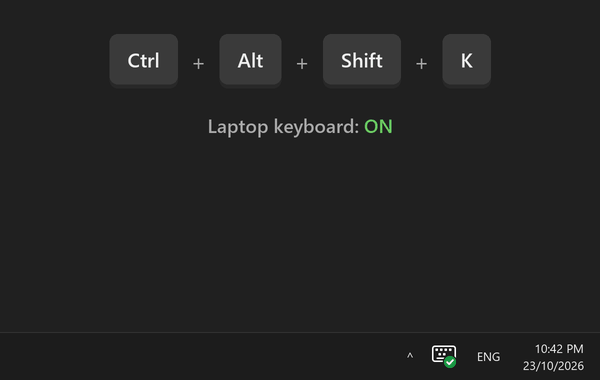

# Keyboard Toggler

Keyboard Toggler is a small Windows tray app. It deactivates the **laptop keyboard** while you use an
external keyboard. Thus, objects on the laptop cannot push the keys of the laptop keyboard. The external keyboard is also
such an object when you put it on the laptop.

Click the tray icon one time to deactivate the laptop keyboard. Click it one more time to activate
the laptop keyboard again. Your external keyboard, the touchpad and the mouse always operate.

We made Keyboard Toggler for an ASUS TUF A16 (FA607PV) with Windows 11. We did the tests on this laptop.

  

|  |  |
|:---:|:---:|
| The laptop keyboard is **on** | The laptop keyboard is **off** |

## Install

1. Download **`KeyboardToggler-Setup.exe`** from the [last release](../../releases/latest).
2. Open the file to start Setup.
3. After the installation, start Windows again. This lets Windows load the Interception driver.

- Keyboard Toggler operates on Windows 10 and Windows 11 on 64-bit Intel or AMD PCs.
- Keyboard Toggler does not operate on Windows on Arm, because the Interception driver is not
  available for Windows on Arm.
- It is not necessary to install other software.
- Setup has no code signature. Thus, Windows can show the message *"Windows protected your PC"*.
  If Windows shows this message, click **More info → Run anyway**. You can compare the SHA-256 of
  the downloaded file with the SHA-256 in the release notes.
- If you update from a previous 2.x version, Keyboard Toggler keeps your adjustments. It is not
  necessary to start Windows again.

## Use Keyboard Toggler

| You do this | Result |
|---|---|
| Click the tray icon | Keyboard Toggler deactivates or activates the laptop keyboard |
| Push **Enter** or click **Keep it off** in the window that shows | The laptop keyboard stays off. If you do not do one of these steps in 15 s, the laptop keyboard is on again |
| Type **Ctrl + Alt + Shift + K** (the standard shortcut) | Keyboard Toggler deactivates or activates the laptop keyboard |
| Right-click the tray icon | The menu shows **Keyboards…**, **Change the shortcut…**, **Start when you sign in**, **Open the log folder** and **Stop Keyboard Toggler** |

**Before you deactivate the laptop keyboard:** Push a key on your external keyboard one time. This
lets Keyboard Toggler know that this keyboard is your external keyboard. Do this step one time for
each new external keyboard.

**If you cannot see the icon:** Windows 11 does not show a new tray icon on the taskbar. To see the
icon, click **^** near the clock. To keep the icon on the taskbar, move it onto the taskbar with the mouse.

### Change the shortcut

1. Right-click the tray icon.
2. Select **Change the shortcut…**.
3. Type the shortcut that you want.
4. Click **Save**.

The shortcut must have Ctrl, Alt or Win plus one more key. Keyboard Toggler does not accept a
shortcut that Windows or a different app uses. **Set to standard** changes the shortcut back to
Ctrl + Alt + Shift + K.

### Select the keyboards that Keyboard Toggler deactivates

Keyboard Toggler finds the laptop keyboard. It is not necessary for you to select it. To examine or
change this selection, do these steps:

1. Right-click the tray icon.
2. Select **Keyboards…**.

If you select **Deactivate** for a keyboard, Keyboard Toggler deactivates that keyboard with the
laptop keyboard. **Set to automatic** cancels your changes.

Some laptops have one more internal device for the Fn keys and the media keys. If you want to
deactivate these keys also, select **Deactivate** for that device.

## Safety

Keyboard Toggler activates the laptop keyboard again in these conditions:

- You do not select **Keep it off** in 15 seconds.
- You disconnect your external keyboard.
- You type the shortcut on one of the keyboards. You can also type it on the laptop keyboard when
  it is off.
- Keyboard Toggler stops. This occurs when you stop it, when an error occurs, or when a different
  app stops it.
- You sign out of Windows, or you start Windows again.

If no external keyboard is connected, Keyboard Toggler does not deactivate the laptop keyboard.

## Compatibility

- **Laptop keyboards:** Keyboard Toggler finds PS/2, I2C and internal USB laptop keyboards. It is not
  necessary for you to select them. Until this time, we did tests only on a PS/2 laptop keyboard.
  If Keyboard Toggler does not find your laptop keyboard, select **Deactivate** for it in the
  **Keyboards…** window. To open this window, right-click the tray icon. Then select **Keyboards…**.
- **Games with anti-cheat software:** Some anti-cheat systems do not accept input filter drivers.
  In a test that we did, Valorant (Riot Vanguard) started correctly. We did not do a test of a full match.
  If you have a problem with a game, uninstall Keyboard Toggler.
- **If you connect keyboards many times:** The Interception driver can record a maximum of 10
  keyboards. If you connect and disconnect keyboards a very large number of times, the driver possibly
  cannot find new keyboards. In this condition, start Windows again.

## If you have a problem

1. Right-click the tray icon. Then select **Keyboards…**. This window shows the keyboards that
   Keyboard Toggler found. **Copy report** copies this data for a problem report.
2. Right-click the tray icon. Then select **Open the log folder**. This folder contains `log.txt`.
   The folder is `%LOCALAPPDATA%\KeyboardToggler`.
3. [Open an issue](../../issues) on GitHub. Include the report and `log.txt`.

## Uninstall

1. Select **Settings › Apps › Installed apps › Keyboard Toggler › Uninstall.**
2. Start Windows again to complete the removal of the Interception driver.

Uninstall removes these items:

- Keyboard Toggler
- The Interception driver
- The Keyboard Toggler item in the Start menu
- The **Start when you sign in** adjustment
- The adjustments of Keyboard Toggler

## More

- [How Keyboard Toggler operates](docs/how-it-works.md): The usual methods cannot deactivate a
  laptop keyboard. This file gives the causes. It also gives the method that Keyboard Toggler uses.
- [Changelog](CHANGELOG.md): This file gives the changes in each version.
- [Make Keyboard Toggler from the source code](docs/development.md): This file gives the procedure
  for software developers.

## License

The license of Keyboard Toggler is the [MIT License](LICENSE).

Setup contains the [Interception](https://github.com/oblitum/Interception) driver. Francisco Lopes
da Silva made this driver. This driver has a different license: LGPL-3.0 for non-commercial use. For more data,
refer to [THIRD-PARTY-NOTICES.md](THIRD-PARTY-NOTICES.md).
