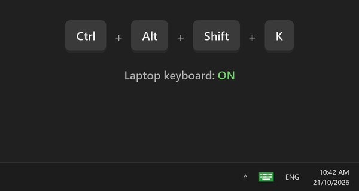

# Keyboard Toggler

A small Windows tray app that switches your **laptop's built-in keyboard off** while you use an
external one, so things resting on the laptop (or the external keyboard itself) can't press keys.
One click on the tray icon turns it off; another turns it back on. Your external keyboard,
touchpad and mouse keep working the whole time.

Built for and tested on an ASUS TUF A16 (FA607PV) with Windows 11.

  

|  |  |
|:---:|:---:|
| Laptop keyboard **on** | Laptop keyboard **off** |

## Install

1. Download **`KeyboardToggler-Setup.exe`** from the [latest release](../../releases/latest) and run it.
2. **Restart once** after the first install so Windows loads the keyboard driver.

- Works on Windows 10 or 11, 64-bit. Nothing else to install.
- The installer isn't code-signed, so Windows may show *"Windows protected your PC"*.
  Click **More info → Run anyway**. You can check the download against the SHA-256 in the release notes.
- Updating from an older 2.x version keeps your settings and doesn't need a restart.

## Using it

| Do this | To |
|---|---|
| Left-click the tray icon | Switch the laptop keyboard off / on |
| Click **Keep it off** in the prompt | Confirm. If you don't answer within 15 s, it turns back on |
| **Ctrl + Alt + Shift + K** (default shortcut) | Switch the laptop keyboard off / on |
| Right-click the tray icon | Status, **Laptop keyboard** choice, **Change shortcut**, start-with-Windows, detected keyboards, log folder, exit |

**First time:** press any key on your external keyboard once before switching off. That's how the
app learns which keyboard is your external one.

**Can't see the icon?** On Windows 11, new tray icons start hidden. Click **^** next to the clock
and drag the icon onto the taskbar.

### Change the shortcut

Right-click the tray icon → **Change shortcut…** and press the combination you want. It needs
Ctrl, Alt or Win plus another key, and the app won't accept one that Windows or another app already
uses. **Reset to default** brings back Ctrl + Alt + Shift + K.

### Choose which keyboard gets switched off

The app finds the built-in keyboard by itself. To check or change it, right-click the tray icon →
**Laptop keyboard**. Ticked keyboards are switched off together; **Reset to automatic** undoes your
changes. Some laptops have a second built-in device for the Fn/media keys: tick it too if those keys
should stop working as well.

## Safety nets

The laptop keyboard comes back on automatically when:

- you don't confirm **Keep it off** within 15 seconds,
- your external keyboard is unplugged,
- you press the shortcut, on any keyboard (including the switched-off laptop keyboard),
- the app exits, crashes or is killed, or you sign out or restart.

It also refuses to switch off when no external keyboard is connected.

## Compatibility

- **Laptop keyboards:** PS/2, I2C and internal-USB built-in keyboards are detected automatically.
  Only PS/2 has been tested on real hardware so far. If yours isn't found, tick it under
  **Laptop keyboard** in the tray menu.
- **Games with anti-cheat:** some anti-cheat systems dislike input filter drivers. Valorant (Riot
  Vanguard) launched fine in testing; a full match hasn't been tested. If a game complains,
  uninstall Keyboard Toggler.
- **Lots of plugging and unplugging:** the driver tracks up to 10 keyboards. After a very large
  number of plug/unplug cycles in one session, new keyboards can stop being seen until you restart.

## Something not working?

- Right-click the tray icon → **Show detected keyboards** to see what the app found.
- Right-click the tray icon → **Open log folder** for `log.txt`
  (it lives in `%LOCALAPPDATA%\KeyboardToggler`).
- Please [open an issue](../../issues) and include both.

## Uninstall

**Settings › Apps › Installed apps › Keyboard Toggler › Uninstall.** This removes the app, the
keyboard driver, the Start menu shortcut, the startup entry and the app's settings. Restart
afterwards to finish removing the driver.

## More

- [How it works](docs/how-it-works.md): why the usual ways of disabling a laptop keyboard fail, and what this app does instead.
- [Changelog](CHANGELOG.md): what changed in each version.
- [Building from source](docs/development.md): for developers.

## License

Keyboard Toggler is released under the [MIT License](LICENSE).

The installer bundles the [Interception](https://github.com/oblitum/Interception) keyboard driver by
Francisco Lopes da Silva, which is licensed separately: LGPL-3.0 for non-commercial use. See
[THIRD-PARTY-NOTICES.md](THIRD-PARTY-NOTICES.md).
